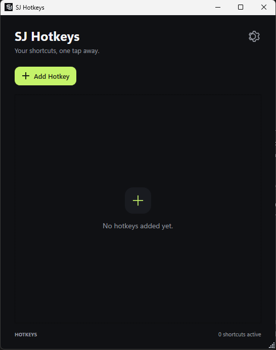
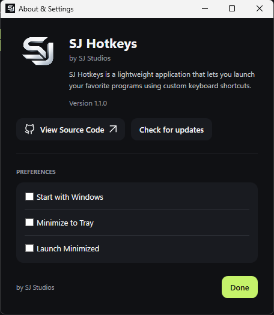

<div align="center">
  

  # SJ Hotkeys

  **Starte deine Windows-Programme mit einer Tastenkombination.**

  Eine schlanke Desktop-App im dunklen Design, mit der du globale Tastenkombinationen unter Windows 10 und Windows 11 erstellst und verwaltest.

  [Windows-Version herunterladen](https://github.com/sjstudios00/SJHotkeys/releases) · [Fehler melden](https://github.com/sjstudios00/SJHotkeys/issues) · [Quellcode ansehen](https://github.com/sjstudios00/SJHotkeys)

  <br />

  
  
  
  
</div>

---

## Kurz vorgestellt

Mit SJ Hotkeys öffnest du deine meistgenutzten Programme im Handumdrehen. Wähle eine ausführbare Datei aus, nimm eine Tastenkombination auf und starte das Programm von überall in Windows – auch wenn ein anderes Fenster im Vordergrund ist.



*Eine echte Aufnahme des SJ-Hotkeys-Fensters, auf die App zugeschnitten. Desktop und andere Apps sind nicht zu sehen.*

### Warum SJ Hotkeys?

- **Schnell eingerichtet:** Wähle eine `.exe`-Datei aus, drücke deine Tastenkombination und speichere sie.
- **Systemweit verfügbar:** Windows-Hotkeys starten Programme auch dann, wenn SJ Hotkeys im Hintergrund läuft.
- **Hält sich im Hintergrund:** Nutze den Infobereich, den Windows-Autostart oder den minimierten Start.
- **Lokal und privat:** Tastenkombinationen und Einstellungen bleiben auf deinem PC. SJ Hotkeys benötigt kein Konto und verwendet weder Analyse noch Telemetrie.
- **Übersichtliche Oberfläche:** Kompaktes dunkles Design, gut erkennbare Tastenkombinationen und gekürzt angezeigte Programmpfade.

## Screenshots für Windows

Beide Bilder sind echte Aufnahmen von SJ Hotkeys unter Windows und auf die jeweiligen App-Fenster zugeschnitten. Desktop und andere Apps sind nicht zu sehen. Die Einstellungsansicht zeigt das offizielle SJ Studios Logo.

| Hotkey-Fenster | Über & Einstellungen |
| --- | --- |
|  |  |

## Herunterladen und installieren

### Option 1: Windows-Version herunterladen

1. Öffne [Releases](https://github.com/sjstudios00/SJHotkeys/releases).
2. Wähle den passenden Download:
   - **Portable:** Läuft ohne separat installierte .NET-Runtime. Beim ersten Start kann die Initialisierung der mitgelieferten Runtime etwas länger dauern.
   - **Lightweight:** Deutlich kleinerer Download; benötigt die **.NET 9 Desktop Runtime (x64)**.
3. Starte die EXE-Datei. Eine Installation oder ein Benutzerkonto ist nicht erforderlich.

Die Lightweight-Version liegt im Repository unter [`release/SJ-Hotkeys-v1.1.0-win-x64-lightweight.exe`](release/SJ-Hotkeys-v1.1.0-win-x64-lightweight.exe). Die eigenständige Portable-Version findest du als Download im [Release v1.1.0](https://github.com/sjstudios00/SJHotkeys/releases/tag/v1.1.0).

> Windows zeigt bei einer unsignierten App aus dem Internet möglicherweise einen SmartScreen-Hinweis. Führe nur Software aus, der du vertraust und die du aus dem offiziellen SJ-Hotkeys-Repository heruntergeladen hast.

### Option 2: Aus dem Quellcode erstellen

**Voraussetzungen:** Windows 10 oder Windows 11 und das .NET 9 SDK. Für die Lightweight-Version wird zusätzlich die [.NET 9 Desktop Runtime](https://dotnet.microsoft.com/download/dotnet/9.0) (x64) benötigt. Die Portable-Version enthält die Runtime.

```powershell
git clone https://github.com/sjstudios00/SJHotkeys.git
cd SJHotkeys
dotnet run --project .\SJHotkeys.csproj
```

So erstellst du die Lightweight-Release-EXE, die eine installierte Runtime benötigt:

```powershell
dotnet publish .\SJHotkeys.csproj -c Release -o .\publish
```

Die veröffentlichte Datei heißt `publish/SJ Hotkeys.exe` und benötigt die .NET 9 Desktop Runtime. Für die eigenständige Portable-Version verwendest du:

```powershell
dotnet publish .\SJHotkeys.csproj -c Release -r win-x64 `
  -p:SelfContained=true `
  -p:IncludeNativeLibrariesForSelfExtract=true `
  -p:EnableCompressionInSingleFile=true `
  -o .\publish\portable
```

Mit dem Skript [`scripts/publish-release.ps1`](scripts/publish-release.ps1) erstellst du die Release-Dateien für v1.1.0 sowie eine SHA-256-Prüfsummendatei.

## Deine erste Tastenkombination

1. Öffne **SJ Hotkeys** und wähle **Add Hotkey**.
2. Wähle über **Browse** die `.exe`-Datei des Programms aus.
3. Klicke auf das Tastenkombinationsfeld und drücke eine Kombination, zum Beispiel `Ctrl + Alt + N`.
4. Wähle **Save Hotkey**.
5. Drücke die Kombination in einer beliebigen App, um das Programm zu starten.

Verwende mindestens eine Sondertaste: **Ctrl**, **Alt**, **Shift** oder **Win**. Innerhalb von SJ Hotkeys kann dieselbe Kombination nicht doppelt vergeben werden. Falls Windows oder eine andere App sie bereits verwendet, informiert dich SJ Hotkeys darüber.

Über **Edit** änderst du Programm oder Tastenkombination. Über die Papierkorb-Schaltfläche entfernst du einen Eintrag. Der vollständige Programmpfad bleibt lokal gespeichert, auch wenn er in der Liste gekürzt angezeigt wird.

## Einstellungen und Infobereich

Über das **Einstellungssymbol** oben rechts findest du diese Optionen:

- **Start with Windows** – SJ Hotkeys beim Anmelden starten.
- **Minimize to Tray** – das Fenster beim Minimieren oder Schließen im Infobereich ausblenden. Über das Tray-Menü kannst du die App wieder öffnen oder beenden.
- **Launch Minimized** – SJ Hotkeys beim Start direkt im Infobereich öffnen.

Tastenkombinationen und Einstellungen werden lokal in deinem Windows-Benutzerprofil gespeichert. Beim Beenden gibt SJ Hotkeys alle globalen Tastenkombinationen frei.

SJ Hotkeys prüft im Hintergrund höchstens einmal alle 24 Stunden, ob es eine neuere Version in den offiziellen GitHub-Releases gibt. Wenn ein Update verfügbar ist, kannst du den passenden Download und die Installation starten. Vor dem Ersetzen und Neustarten der App wird der Download anhand der SHA-256-Prüfsummendatei überprüft.

## Datenschutz

SJ Hotkeys ist auf lokale Nutzung ausgelegt:

- Kein Benutzerkonto und keine Anmeldung.
- Keine Analyse und keine Telemetrie.
- Programmpfade, Tastenkombinationen und Einstellungen bleiben in der lokalen Einstellungsdatei.
- Für die Updateprüfung ruft die App den öffentlichen GitHub-Releases-Feed ab. Update-Dateien werden erst nach deiner Bestätigung heruntergeladen.
- Es werden keine Tastenkombinationen oder Einstellungen an GitHub gesendet.

## Technologie

- C# und .NET 9
- Windows Presentation Foundation (WPF)
- Windows-API `RegisterHotKey` für globale Tastenkombinationen
- Lokale JSON-Konfiguration im Windows-Benutzerprofil
- Framework-abhängige und eigenständige `win-x64`-Einzeldatei-Veröffentlichungen
- Native Windows-Hotkeys ohne Tastatur-Abfrageschleife

## Mitwirken und Fehler melden

Du hast einen Fehler gefunden oder eine Idee? Erstelle bitte ein [Issue](https://github.com/sjstudios00/SJHotkeys/issues) mit deiner Windows-Version und klaren Schritten zur Reproduktion. Füge Screenshots oder Logs keine persönlichen Daten und privaten Dateipfade hinzu.

## Lizenz

SJ Hotkeys wird unter der [MIT-Lizenz](LICENSE) veröffentlicht.

---

<div align="center">
  <strong>SJ Hotkeys</strong><br />
  by SJ Studios
</div>
