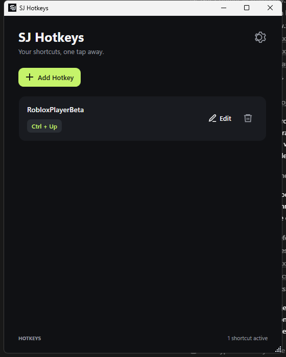

<div align="center">
  

  # SJ Hotkeys

  **Launch your favorite Windows apps with a shortcut.**

  A lightweight, dark-mode desktop app for creating and managing global keyboard shortcuts on Windows 10 and Windows 11.

  [Download for Windows](https://github.com/sjstudios00/SJHotkeys/releases) · [Report a bug](https://github.com/sjstudios00/SJHotkeys/issues) · [View source](https://github.com/sjstudios00/SJHotkeys)

  <br />

  
  
  
  
</div>

---

## At a glance

SJ Hotkeys makes it easy to open the programs you use most. Choose an executable, record a key combination, and launch that program from anywhere in Windows—even while another app is in front.



*Screenshot captured from the running Windows application. Full paths stay saved locally and are available as a tooltip on each shortcut card.*

### Why SJ Hotkeys?

- **Fast to set up:** browse to an `.exe`, press a shortcut, and save.
- **Works system-wide:** Windows global hotkeys can launch your programs while SJ Hotkeys is in the background.
- **Stays out of your way:** keep it in the system tray, start it with Windows, or launch it minimized.
- **Local by design:** shortcuts and preferences are stored on your PC. SJ Hotkeys has no account, analytics, or telemetry.
- **A focused interface:** a compact dark UI, clear shortcut badges, and neatly trimmed program paths.

## Windows screenshots

The main-window image above is a direct capture of the running Windows build. The About and Settings panel uses the official SJ Studios logo and native Windows controls.

## Download and install

### Option 1: Download the Windows build

1. Open [Releases](https://github.com/sjstudios00/SJHotkeys/releases).
2. Choose the download that fits your PC:
   - **Portable:** runs without a separate .NET installation. The first launch can take a little longer while Windows initializes the bundled runtime.
   - **Lightweight:** a much smaller download; it requires the **.NET 9 Desktop Runtime (x64)**.
3. Run the executable. No installer or account is required.

The repository includes the lightweight build at [`release/SJ-Hotkeys-v1.1.0-win-x64-lightweight.exe`](release/SJ-Hotkeys-v1.1.0-win-x64-lightweight.exe). The standalone portable executable is attached to the [v1.1.0 release](https://github.com/sjstudios00/SJHotkeys/releases/tag/v1.1.0).

> Windows may show a SmartScreen prompt for an unsigned app downloaded from the internet. Only run software you trust and have obtained from the official SJ Hotkeys repository.

### Option 2: Build from source

**Requirements:** Windows 10 or Windows 11 and the .NET 9 SDK. The lightweight executable also needs the [.NET 9 Desktop Runtime](https://dotnet.microsoft.com/download/dotnet/9.0) (x64). The portable executable bundles the runtime.

```powershell
git clone https://github.com/sjstudios00/SJHotkeys.git
cd SJHotkeys
dotnet run --project .\SJHotkeys.csproj
```

To create the lightweight framework-dependent release executable:

```powershell
dotnet publish .\SJHotkeys.csproj -c Release -o .\publish
```

The published executable will be `publish/SJ Hotkeys.exe`. This framework-dependent build requires the .NET 9 Desktop Runtime. To publish the self-contained portable variant:

```powershell
dotnet publish .\SJHotkeys.csproj -c Release -r win-x64 `
  -p:SelfContained=true `
  -p:IncludeNativeLibrariesForSelfExtract=true `
  -p:EnableCompressionInSingleFile=true `
  -o .\publish\portable
```

To build the exact v1.1.0 release assets and a SHA-256 checksum manifest, run [`scripts/publish-release.ps1`](scripts/publish-release.ps1).

## Create your first shortcut

1. Open **SJ Hotkeys** and select **Add Hotkey**.
2. Choose the program's `.exe` file with **Browse**.
3. Click the shortcut field and press a combination, such as `Ctrl + Alt + N`.
4. Select **Save Hotkey**.
5. Press the shortcut from any app to launch the program.

Use at least one modifier key: **Ctrl**, **Alt**, **Shift**, or **Win**. A shortcut cannot be assigned twice in SJ Hotkeys. If Windows or another app already owns it, SJ Hotkeys will explain that it is unavailable.

Use **Edit** to change a program or shortcut, or the trash button to remove an entry. The full executable path is retained in local settings even when its display is shortened in the list.

## Preferences and system tray

Open the **settings button** in the upper-right corner to find:

- **Start with Windows** — launch SJ Hotkeys when you sign in.
- **Minimize to Tray** — hide the window in the notification area when minimized or closed. Use the tray menu to reopen or exit the app.
- **Launch Minimized** — start with the window hidden in the tray.

Shortcut definitions and preferences are saved locally under your Windows user profile. Global shortcuts are released when SJ Hotkeys exits.

SJ Hotkeys checks the official GitHub Releases endpoint at most once every 24 hours in the background. When a newer release is available, it offers to download and install the matching build. Downloads are verified against the SHA-256 release manifest before the app is replaced and restarted.

## Privacy

SJ Hotkeys is designed to run locally:

- No user account or sign-in.
- No analytics or telemetry.
- Program paths, shortcuts, and preferences stay in the local settings file.
- The app checks the public GitHub Releases feed for updates; update binaries are downloaded only after confirmation.
- No shortcut or preference data is sent to GitHub.

## Technology

- C# and .NET 9
- Windows Presentation Foundation (WPF)
- Windows `RegisterHotKey` API for global shortcuts
- Local JSON configuration in the current Windows user profile
- Framework-dependent and self-contained `win-x64` single-file publishing
- Native Windows global hotkeys; no keyboard polling loop

## Contributing and issues

Found a problem or have an idea? Please [open an issue](https://github.com/sjstudios00/SJHotkeys/issues) with your Windows version and clear steps to reproduce it. Do not include personal data or private file paths in screenshots or logs.

## License

SJ Hotkeys is distributed under the [MIT License](LICENSE).

---

<div align="center">
  <strong>SJ Hotkeys</strong><br />
  by SJ Studios
</div>
